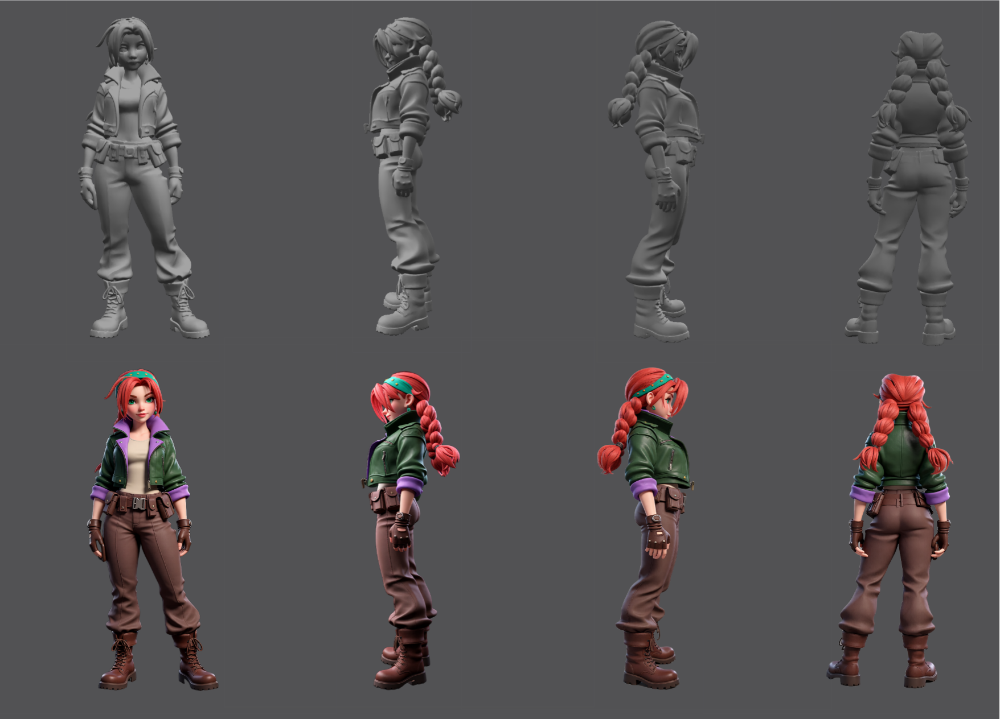
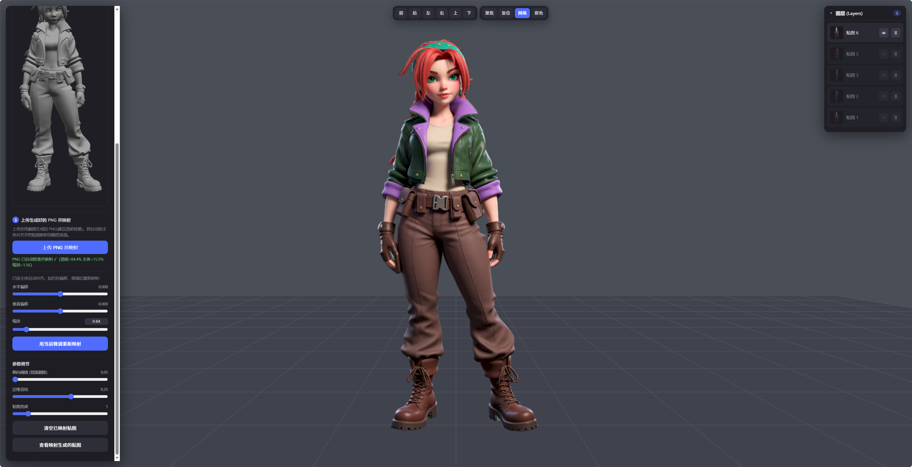

# Texture Generator & Mapper

基于 Three.js 与 ComfyUI 的 AI 多视角贴图生成、对齐和 UV 映射工具，界面名称为 **Bake Studio**。

面向角色贴图制作验证：导入带 UV 的白模和角色参考图，从当前视角生成贴图，将结果投影烘焙到模型 UV，逐视角补全后导出 PNG 或带贴图的 GLB。

## 效果展示





更多过程图见 [演示素材](testfiles/final对比图)。这些图片是已有项目演示结果，不代表对任意模型的效果保证。

## 功能与实现

- **模型预览**：加载 GLB / OBJ，旋转、缩放、平移及六方向视角切换。
- **AI 贴图生成**：当前视角白模截图与 1–6 张参考图提交至 ComfyUI，使用 Qwen Image Edit 2509 与 RMBG 去背景。
- **自动与手动对齐**：主程序按透明主体包围盒对齐，并提供手动微调；独立对齐工具另提供 rembg、ECC 配准与 IoU 择优。
- **UV 投影烘焙**：在浏览器中使用 WebGL，将当前视角贴图写入 UV，结合深度遮挡、朝向阈值与边缘羽化控制覆盖。
- **多视角图层与导出**：各视角独立图层，支持管理和调节，导出 UV PNG 或带贴图 GLB。
- **任务记录**：本地保存输入截图、参考图、相机、实际工作流与生成结果。

## 快速开始

### 1. 安装本地服务依赖

使用 Python 3.10+，在本项目根目录打开终端：

```powershell
python -m venv .venv
.\.venv\Scripts\python.exe -m pip install -r requirements.txt
.\.venv\Scripts\python.exe server.py
```

浏览器打开 `http://127.0.0.1:8765/`。前端依赖已放在 `vendor/`，不需要 npm 构建。

如果当前 `python` 环境已安装依赖，也可双击 `启动工具.cmd`，或执行 `python launch.py` 自动打开浏览器。该启动方式在后台运行服务，日志写入 `server.local.log`。

### 2. 配置 AI 生成环境

AI 生成需要另外运行 ComfyUI，并安装 [模型与节点配置](docs/模型配置.md) 中的依赖；默认连接 `http://127.0.0.1:8188`。仓库不包含 ComfyUI、模型权重或 GPU 运行环境。

尚未配置 ComfyUI 时，可以打开界面、加载模型，并使用手动导入贴图与映射功能；AI 生成不可用。

若端口不同，在启动本地服务前设置：

```powershell
$env:COMFY_URL = 'http://127.0.0.1:8188'
$env:PORT = '8765'
.\.venv\Scripts\python.exe server.py
```

### 3. 完成一次贴图流程

1. 上传带有效 UV 的 GLB / OBJ，或加载内置 Demo。
2. 上传同一角色的参考图；Demo 使用仓库内的示例参考图。
3. 调整到目标视角，点击“生成并映射当前视角”。
4. 检查生成结果及映射位置，必要时在手动对齐面板微调。
5. 切换视角继续生成，补全未覆盖区域。
6. 导出 UV PNG 或带贴图 GLB；刷新页面前先保存。

### 操作与任务记录

在视口中左键拖动旋转、滚轮缩放、右键平移；顶部可切换六个方向，按 F 键聚焦。生成任务会保存截图时的相机，等待生成期间仍可旋转预览。

单张参考图保留透明通道，多张参考图会合成参考板。主程序使用 `active_workflow_api.json`，替换图片输入、采样种子，并在填写补充要求时追加提示词；模型、LoRA、采样步数、1024 补边和去背景参数沿用工作流配置。节点绑定见 [模型与节点配置](docs/模型配置.md)。

生成结果返回后，主程序按透明主体包围盒对齐到截图主体，再投影烘焙。每次生成增加一个贴图图层，可在“手动导入贴图与对齐”中微调，并在“贴图调节与导出”中保存结果。

顶部显示 ComfyUI 连接状态，缺少节点或模型时会在生成区提示。任务文件保存在 `runs/<任务编号>/`，包含截图、参考图、相机、实际提交工作流、任务状态和生成结果。可恢复任务状态并下载结果，但不会把旧任务自动映射到新加载的模型；服务重启也不会自动重新提交 GPU 任务。

浏览器提示“拒绝连接”时，请检查本地服务是否运行；通过启动工具运行的服务可查看 `server.local.log`。本地服务和资源检查不能替代完整 AI 生成验证，实际生成效果需在配置好的 ComfyUI 环境中测试。

## 目录说明

| 路径 | 内容 |
| --- | --- |
| `index.html` / `studio.js` | 界面、Three.js 视口、图层和 UV 烘焙 |
| `server.py` | 本地 HTTP 服务、ComfyUI 调用和任务记录 |
| `launch.py` / `启动工具.cmd` | 启动入口 |
| `requirements.txt` | 主程序 Python 依赖 |
| `docs/模型配置.md` | ComfyUI 模型、节点与输入输出绑定说明 |
| `active_workflow_api.json` | 主程序实际调用的 API 工作流 |
| `vendor/three/` | 随仓库提供的 Three.js 依赖及 LICENSE |
| `testfiles/` | Demo 模型、参考图及效果展示 |
| `workflow/` | 辅助及备选工作流，不会自动由主程序执行 |
| `SubjectAlign/` | 独立 Python GUI 和 ComfyUI 对齐节点 |
| `Marigold_Delight/` | 独立去光实验工具，未接入主程序 |
| `runs/` | 运行后生成的本地任务文件，Git 忽略 |

## 独立辅助工具

对齐 GUI 的安装与启动：

```powershell
cd "SubjectAlign/Python脚本"
python -m pip install -r requirements.txt
python align_gui.py
```

ComfyUI 节点的安装见 [节点说明](SubjectAlign/ComfyUI-SubjectAlign/README.md)。独立去光工具见 [Marigold 使用说明](Marigold_Delight/README.md)，需要额外安装依赖和下载模型，不影响主程序启动。

## 当前限制

- 输入模型需提前展开 UV；重叠 UV、蒙皮动画模型不在当前支持范围内。
- 单次映射覆盖当前可见面，多视角一致性、遮挡区域和接缝仍需人工检查。
- AI 可能改变轮廓、局部结构或引入光影，不能保证直接得到可用于生产的纯固有色贴图。
- 刷新页面会丢失浏览器中的模型和图层；任务记录不等同于可恢复的完整编辑工程。
- 服务默认只监听本机，定位为本地原型工具。

## 提交说明与文档

以本目录作为 GitHub 仓库根目录。`.gitignore` 排除模型权重、环境、缓存、日志、任务输出及本地去光测试记录，保留 Demo 必需的 `testfiles/红发女孩.glb` 和 `testfiles/红发女上色.png`。

Three.js 的许可保留在 [vendor/three/LICENSE](vendor/three/LICENSE)。第三方模型、节点与演示素材各自的授权不由本仓库统一授予。

- [模型与节点配置](docs/模型配置.md)
